# V03 — Filesystem

## Escenario

El cliente necesita una estructura de directorios estandarizada en el servidor antes de empezar a desplegar la aplicación. Como sysadmin definí la estructura, asigné permisos por rol y documenté el propósito de cada directorio.

## Estructura creada

```text
/srv/project/
├── src/       → código fuente (devops:devops 755)
│   ├── app/
│   ├── tests/
│   └── scripts/
├── config/    → configuraciones (root:devops 750)
├── logs/      → logs aplicación (root:devops 755/644)
├── backups/   → backups (root:root 700)
└── tmp/       → temporales (sticky bit 1777)

/etc/project/          → configuración global del sistema
/var/log/project/      → logs del sistema del proyecto
/opt/project/bin/      → binarios del proyecto
```

## Por qué cada directorio tiene esos permisos

| Directorio | Permisos | Razón |
|------------|----------|-------|
| src/ | `755 devops:devops` | El dueño administra y escribe; el resto del equipo solo lee |
| config/ | `750 root:devops` | Solo el administrador modifica configuraciones |
| logs/ | `755` dir / `644` archivos | El sistema escribe; los usuarios solo leen |
| backups/ | `700 root:root` | Nadie excepto root toca los backups |
| tmp/ | `1777` sticky bit | Cualquiera escribe, pero nadie borra archivos ajenos |

## Conceptos aplicados

### Sticky bit

Activo en `/srv/project/tmp`. Permite que cualquier usuario cree archivos en esa carpeta, pero solo el dueño del archivo puede eliminarlo. Exactamente como funciona `/tmp` en Linux.

### Enlaces simbólicos

`/srv/project/config/app.conf` es un symlink que apunta a `/etc/project/app.conf`. Mantiene las configuraciones en `/etc` (estándar de Linux) pero accesibles desde el proyecto.

### Filesystem Hierarchy Standard (FHS)

Linux tiene un estándar que define para qué sirve cada directorio raíz. Seguirlo hace el servidor predecible para cualquier sysadmin que llegue después.

| Directorio | Propósito estándar |
|------------|-------------------|
| /srv/ | Datos de servicios del servidor |
| /etc/ | Archivos de configuración |
| /var/log/ | Logs del sistema |
| /opt/ | Software de terceros |
| /tmp/ | Archivos temporales (se borra al reiniciar) |

## Comandos aprendidos

| Comando | Descripción |
|---------|-------------|
| `mkdir -p dir/{sub1,sub2,sub3}` | Crear árbol completo de una vez |
| `tree -p directorio` | Ver árbol con permisos |
| `du -sh directorio/*` | Tamaño de cada subdirectorio |
| `df -hT` | Filesystems montados con tipo |
| `df -i` | Inodos disponibles |
| `find /ruta -name "*.py" -type f` | Buscar por nombre y tipo |
| `find /ruta -mtime -1` | Archivos modificados últimas 24 h |
| `find /ruta -perm 644` | Buscar por permisos |
| `find /ruta -size +1M` | Buscar por tamaño |
| `ln -s origen destino` | Crear enlace simbólico |
| `readlink -f symlink` | Ver a dónde apunta el symlink |
| `findmnt` | Ver puntos de montaje activos |
| `lsblk` | Ver dispositivos de bloque |
| `chmod 1777 directorio` | Activar sticky bit |

## Evidencia

### Exploración del filesystem

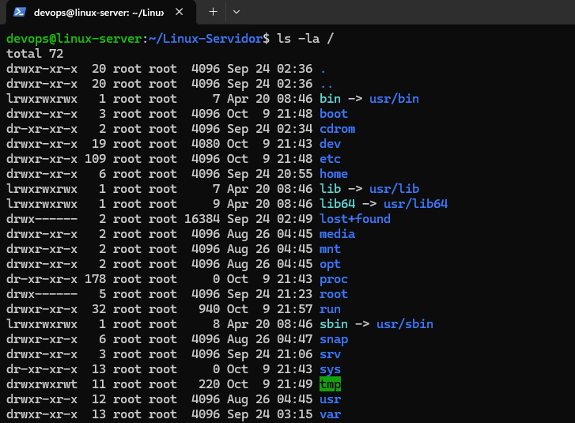

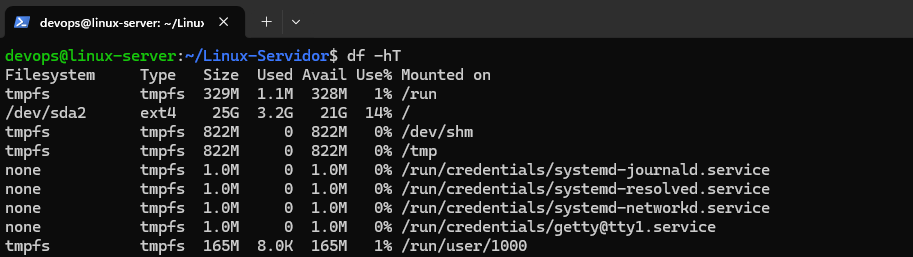

### Estructura creada

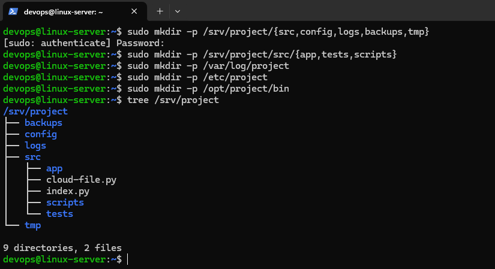

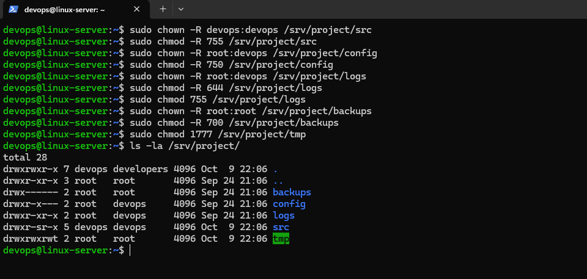

### Conceptos aplicados

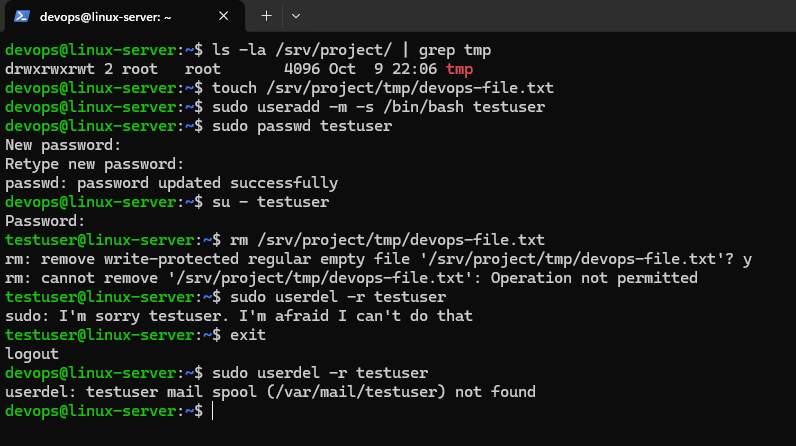

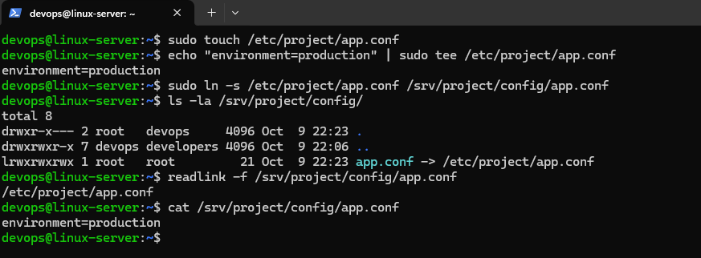

### Búsqueda de archivos

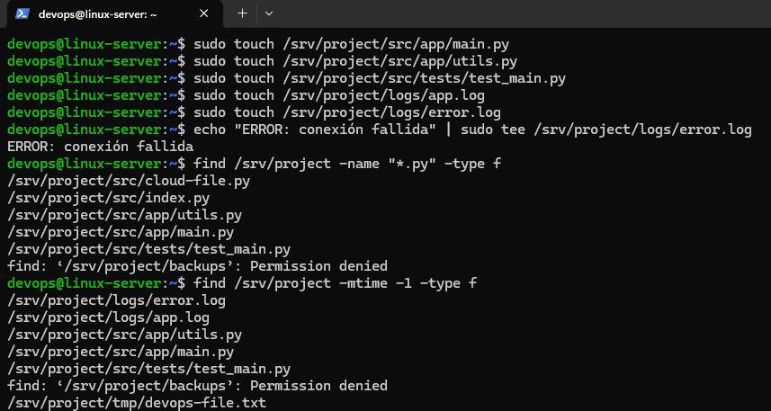

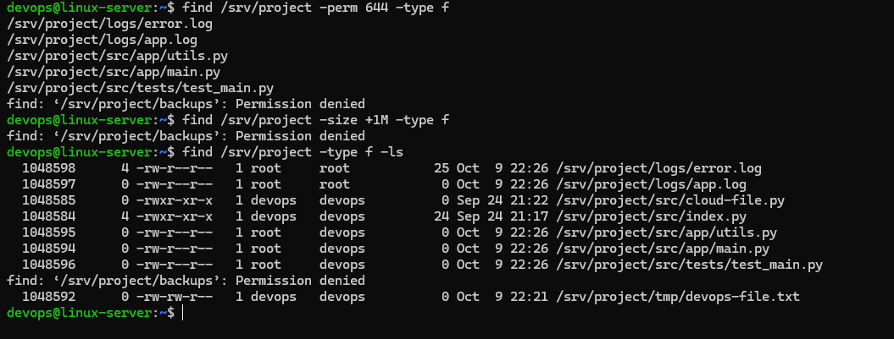

### Administración del disco

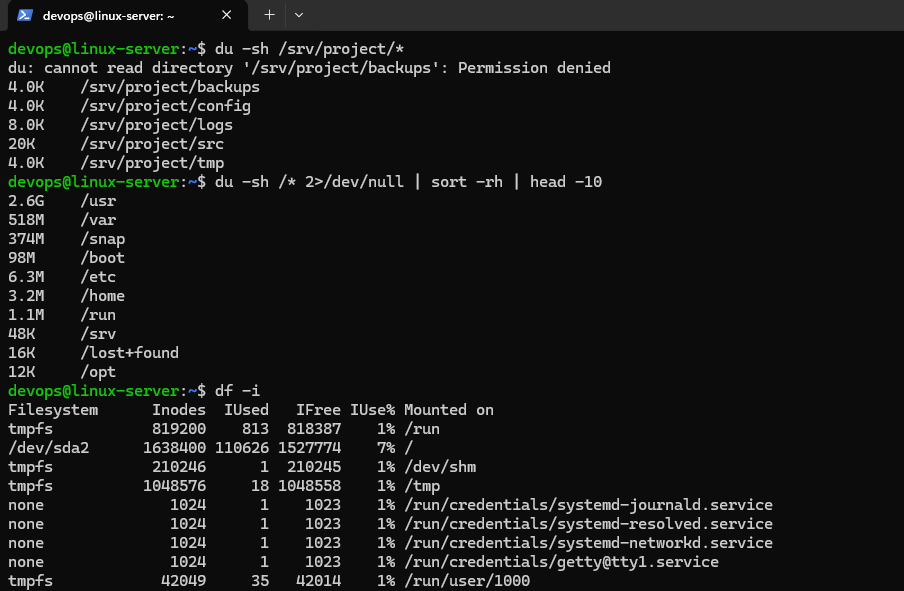

### Sistema y montaje

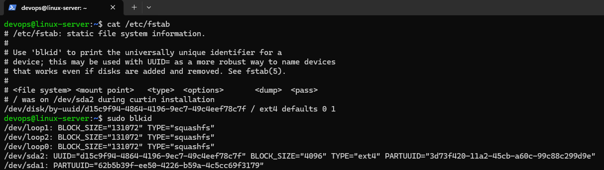

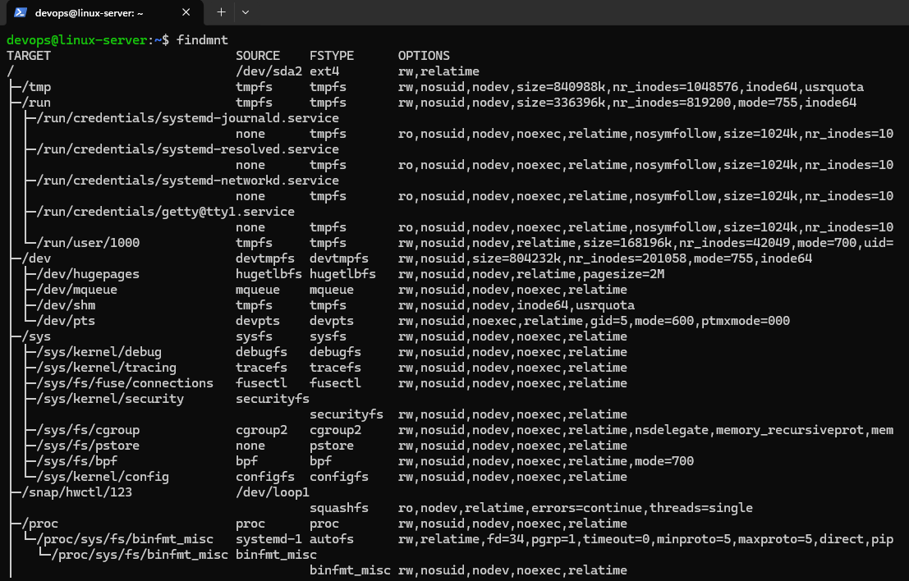

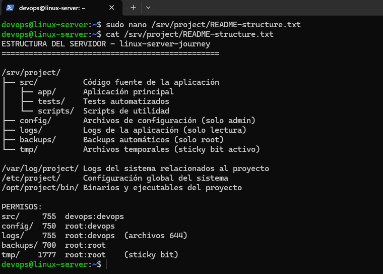

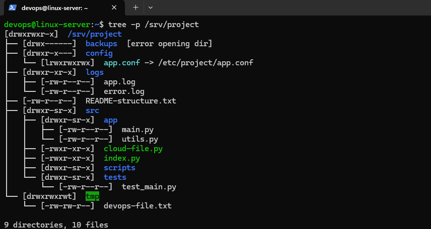

## Lo que aprendí

El Filesystem Hierarchy Standard no es solo una convención: es lo que hace que cualquier sysadmin pueda trabajar en cualquier servidor Linux sin perderse. Poner archivos en lugares incorrectos genera caos en producción.

El sticky bit resuelve un problema real: en carpetas compartidas sin él, cualquier usuario puede borrar archivos de otros. Con él, cada quien solo borra lo suyo.